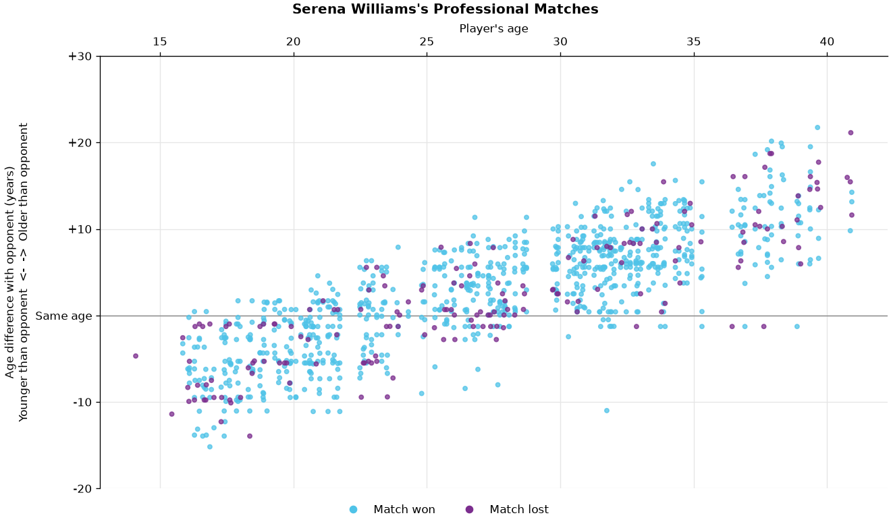

# tennis_age_gap

A small Python package that downloads a tennis player's career matches from
[tennisabstract.com](https://www.tennisabstract.com) and draws a scatter plot in the
style of the New York Times graphic on Serena Williams's opponents:

- x-axis: the player's age at the time of the match
- y-axis: the player's age minus the opponent's age
- color: whether the player won or lost the match

STAT 159/259 HW3 (Fall 2026), the continuation of HW1 and HW2.



## Installation

```bash
pip install git+https://github.com/UCB-stat159-f26/hw03-3-gwanhokong.git
```

Requires Python 3.9 or later. `pandas`, `matplotlib` and `requests` are installed automatically.

## Usage

```python
from tennis_age_gap import get_career_matches, plot_age_gap

# Serena Williams data and plot
serena = get_career_matches("serena williams")
plot_age_gap(serena, title="Serena Williams's Professional Matches")

# Rafael Nadal data and plot
rafa = get_career_matches("Rafael Nadal")
plot_age_gap(rafa)

# returns a meaningful error message
unknown_player = get_career_matches("GastonSanchez")
# ValueError: No career data found for 'GastonSanchez' on tennisabstract.com.
# Check the spelling of the player's name, e.g. 'Serena Williams'.
```

Outside Jupyter, show or save the plot with `matplotlib.pyplot.show()` or
`ax.figure.savefig("plot.png")`, where `ax` is the value returned by `plot_age_gap()`.

## Public functions

| Function | Input | Output |
|---|---|---|
| `get_career_matches(player_name)` | a player name such as `"serena williams"`, `"Serena Williams"` or `"SerenaWilliams"` | a pandas DataFrame with one row per match |
| `plot_age_gap(matches, title=None)` | the DataFrame returned by `get_career_matches()`, and an optional title | the matplotlib `Axes` of the scatter plot |

Columns of the data frame:

| Column | Meaning |
|---|---|
| `match_date` | date of the match |
| `opponent` | opponent's name |
| `result` | `"win"` or `"loss"` |
| `player_age` | player's age in years on the match date |
| `opponent_age` | opponent's age in years on the match date |
| `age_diff` | `player_age - opponent_age` (positive: the player was older) |

## How it works

1. The name is normalized to the form used in tennisabstract URLs (`"serena williams"` becomes `SerenaWilliams`).
2. The file `jsmatches/<Name>Career.js` is downloaded. If the server answers 404, a `ValueError` explains that the player was not found.
3. The JavaScript assignment `var morematchmx = [[...], ...];` is turned into a list of rows with `json`.
4. **Female vs male files.** Field 17 of each row holds the opponent's birth date (`"19770119"`) in women's files but the opponent's age (`"22.264202601"`) in men's files. The package detects the format by looking for a decimal point and derives the age from the birth date when needed.
5. The career file does not contain the player's own birth date, so it is read from the player page (`wplayer.cgi` for women, `player.cgi` for men), which includes `var dob = 19810926;`.
6. Ages are computed as days between dates divided by 365.25, the same rule as in HW2. For Serena Williams the result matches the HW2 data set (1038 matches) to within floating-point error.

## Package structure

```
src/tennis_age_gap/
├── __init__.py   exposes the two public functions
├── data.py       get_career_matches()        (public)
├── plot.py       plot_age_gap()              (public) and private plotting helpers
├── fetch.py      private helpers that download files (network access)
└── clean.py      private helpers that parse and clean the files (no network access)
tests/
├── data/         mock female and male career JS files from the assignment
├── test_clean.py
└── test_fetch.py
```

Downloading and cleaning live in separate modules so that the cleaning code can be tested
without the internet. Every function is shorter than 20 lines, and private helpers are
kept to about 10 lines.

## Running the tests

```bash
git clone https://github.com/UCB-stat159-f26/hw03-3-gwanhokong.git
cd hw03-3-gwanhokong
pip install -e ".[test]"
python -m pytest -v
```

The tests never contact tennisabstract.com. They use the mock career files in `tests/data/`,
and the unknown-player test replaces the download function with a fake one that behaves like
a 404 response (`monkeypatch`).

## Known limitation

For some players the `Career.js` file holds only part of the career. Rafael Nadal played
until 2024, but his file covers 2001-09-10 to 2016-10-10 (ages 15 to 30), so his plot stops
at age 30. The package plots exactly what the career file contains, as the assignment specifies.

tennisabstract.com may answer `429 Too Many Requests` when many players are requested in a row. The package then waits and retries up to three times (5, 15 and 30 seconds), so downloading several players back to back can take a little longer.


## Personal reflections

I did HW2 in R, but I built this package in Python. Moving the same logic to a different language made me check whether I actually understood the calculations I had written in R with `as.Date` and `/ 365.25`. When I compared my results with the `serena.csv` file from HW2, all 1038 matches agreed down to floating-point error, so I saw for myself that the same analysis could be reproduced with a different tool.

The most surprising part was that the Career.js file alone does not contain everything the plot needs. First, the data has no column names, and the same 17th field means different things depending on the player: in women's files it is the opponent's birth date (`19770119`), but in men's files it is already the opponent's age (`22.264202601`). I solved this with a small function that treats a file as the men's format if that field has a decimal point. Second, when I checked the variables inside the file with `curl` and `grep`, there was only `morematchmx`, and the player's own birth date was not there at all. I never noticed this in HW2 because I had typed Serena's birthday directly into the code. In the end I read `var dob` from the player's page, but men's pages use `player.cgi` and women's pages use `wplayer.cgi`, so the same men/women function turned out to be needed here too.

At first the 20-line limit felt like a hassle. `_clean_matches`, which builds the final data frame, got longer than I expected, so I had to move the part that holds the date, opponent name and result into a separate `_base_frame` function. Splitting the plot into drawing points, styling the axes and adding the legend also made the public function `plot_age_gap` so short that it reads almost like a checklist. But once I got used to it, small functions meant I could run and check each one right after writing it. For example, right after writing `_parse_dob`, I checked that it returned `19810926` from Serena's page, committed it, and moved on to the next function.

The newest thing for me in testing was `monkeypatch`. I wanted to test that a meaningful error appears for a player who does not exist, but that requires the server to return a 404. By using `monkeypatch` to temporarily swap the download function for a fake one that always returns `None`, I could create that situation and test it without the internet. I also used numbers I had already checked on real data as the expected values in the tests. The age difference of -4.684 in Serena's first match is a value I verified against HW2, so putting it in a test means that if I change the code later, the tests will automatically tell me whether I still get the same result as HW2.

The code ran without errors, but when I opened Nadal's plot, the x-axis stopped at age 30. Nadal played until 2024, when he was 38, so this looked wrong. When I printed the date range, the data only went from September 2001 to October 2016. This showed me that passing tests does not guarantee correct results, and that looking at the output with my own eyes is a step I can't skip. However, this was not a bug in my code but a limitation of the data source. Since the assignment asks us to use the Career.js file, I kept the code as it is and instead recorded the issue as a known limitation in this README. I think reproducible research is not only about others getting the same result when they run the same code, but also about telling them what that result includes and what it leaves out.

Looking back, this was a lesson I could apply directly to my earlier projects. In my H1B Sponsorship Analytics project, the USCIS files had different encodings (UTF-16) and column names, so I fixed them by hand every time. If I had written a small function to detect the file format and tests with a few sample rows from each format, like I did here for the men's and women's files, I probably would not have kept repeating the same fixes.

## AI usage disclosure

**Tool:** Claude (Anthropic), model Claude Opus 5.5


## AI Usage Disclosure

**AI Tool:** Claude (Anthropic), Claude Opus 5.5

I used Claude Opus 5.5 as a learning and development assistant while working on this assignment. My primary goal was to better understand Python package development, improve code organization, and explore effective approaches to data processing and testing.

Specifically, I used AI assistance for the following purposes:

- **Conceptual understanding:** To clarify concepts related to Python package structure, data parsing, and unit testing.
- **Code development:** To discuss possible implementation approaches, troubleshoot errors, and improve code readability and organization.
- **Testing:** To better understand how to design unit tests using mock data without making requests to live servers.
- **Documentation:** To improve the clarity and organization of the README and code documentation.

I treated AI-generated suggestions as references rather than automatically accepting them. I reviewed the suggested approaches, tested the code, and made adjustments based on my understanding of the assignment requirements.

I take responsibility for the final implementation, including its functionality, correctness, and documentation. AI served as a supporting tool throughout the development process rather than a substitute for understanding the code.

