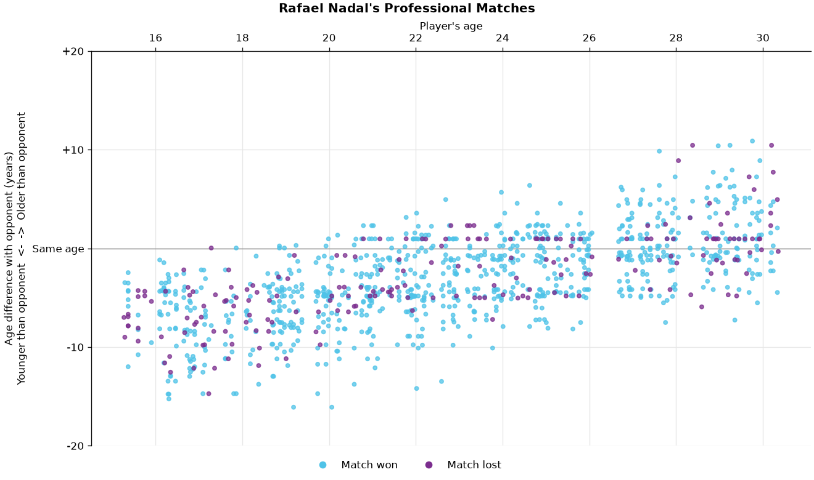

# tennis_age_gap

A small Python package that downloads a tennis player's career matches from
[tennisabstract.com](https://www.tennisabstract.com) and draws a scatter plot in the
style of the New York Times graphic on Serena Williams's opponents:

- x-axis: the player's age at the time of the match
- y-axis: the player's age minus the opponent's age
- color: whether the player won or lost the match

STAT 159/259 HW3 (Fall 2026), the continuation of HW1 and HW2.


## Installation

```bash
pip install git+https://github.com/UCB-stat159-f26/hw03-3-gwanhokong.git
```

Requires Python 3.9 or later. `pandas`, `matplotlib` and `requests` are installed automatically.

## Usage

```python
from tennis_age_gap import get_career_matches, plot_age_gap

# Serena Williams data and plot
serena = get_career_matches("serena williams")
plot_age_gap(serena, title="Serena Williams's Professional Matches")

# Rafael Nadal data and plot
rafa = get_career_matches("Rafael Nadal")
plot_age_gap(rafa)

# returns a meaningful error message
unknown_player = get_career_matches("GastonSanchez")
# ValueError: No career data found for 'GastonSanchez' on tennisabstract.com.
# Check the spelling of the player's name, e.g. 'Serena Williams'.
```

Outside Jupyter, show or save the plot with `matplotlib.pyplot.show()` or
`ax.figure.savefig("plot.png")`, where `ax` is the value returned by `plot_age_gap()`.

## Public functions

| Function | Input | Output |
|---|---|---|
| `get_career_matches(player_name)` | a player name such as `"serena williams"`, `"Serena Williams"` or `"SerenaWilliams"` | a pandas DataFrame with one row per match |
| `plot_age_gap(matches, title=None)` | the DataFrame returned by `get_career_matches()`, and an optional title | the matplotlib `Axes` of the scatter plot |

Columns of the data frame:

| Column | Meaning |
|---|---|
| `match_date` | date of the match |
| `opponent` | opponent's name |
| `result` | `"win"` or `"loss"` |
| `player_age` | player's age in years on the match date |
| `opponent_age` | opponent's age in years on the match date |
| `age_diff` | `player_age - opponent_age` (positive: the player was older) |

## How it works

1. The name is normalized to the form used in tennisabstract URLs (`"serena williams"` becomes `SerenaWilliams`).
2. The file `jsmatches/<Name>Career.js` is downloaded. If the server answers 404, a `ValueError` explains that the player was not found.
3. The JavaScript assignment `var morematchmx = [[...], ...];` is turned into a list of rows with `json`.
4. **Female vs male files.** Field 17 of each row holds the opponent's birth date (`"19770119"`) in women's files but the opponent's age (`"22.264202601"`) in men's files. The package detects the format by looking for a decimal point and derives the age from the birth date when needed.
5. The career file does not contain the player's own birth date, so it is read from the player page (`wplayer.cgi` for women, `player.cgi` for men), which includes `var dob = 19810926;`.
6. Ages are computed as days between dates divided by 365.25, the same rule as in HW2. For Serena Williams the result matches the HW2 data set (1038 matches) to within floating-point error.

## Package structure

```
src/tennis_age_gap/
├── __init__.py   exposes the two public functions
├── data.py       get_career_matches()        (public)
├── plot.py       plot_age_gap()              (public) and private plotting helpers
├── fetch.py      private helpers that download files (network access)
└── clean.py      private helpers that parse and clean the files (no network access)
tests/
├── data/         mock female and male career JS files from the assignment
├── test_clean.py
└── test_fetch.py
```

Downloading and cleaning live in separate modules so that the cleaning code can be tested
without the internet. Every function is shorter than 20 lines, and private helpers are
kept to about 10 lines.

## Running the tests

```bash
git clone https://github.com/UCB-stat159-f26/hw03-3-gwanhokong.git
cd hw03-3-gwanhokong
pip install -e ".[test]"
python -m pytest -v
```

The tests never contact tennisabstract.com. They use the mock career files in `tests/data/`,
and the unknown-player test replaces the download function with a fake one that behaves like
a 404 response (`monkeypatch`).

## Known limitation

For some players the `Career.js` file holds only part of the career. Rafael Nadal played
until 2024, but his file covers 2001-09-10 to 2016-10-10 (ages 15 to 30), so his plot stops
at age 30. The package plots exactly what the career file contains, as the assignment specifies.


